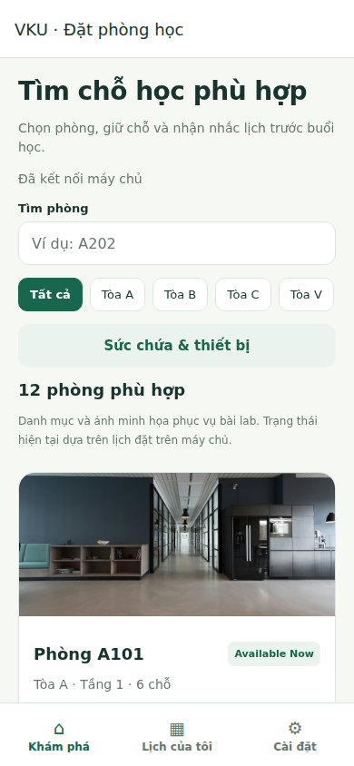
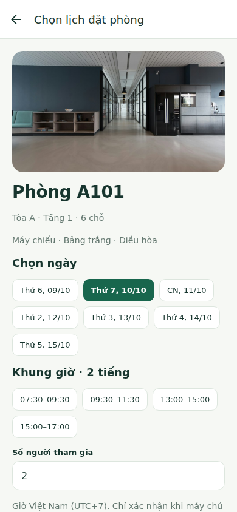
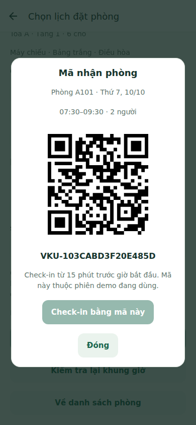
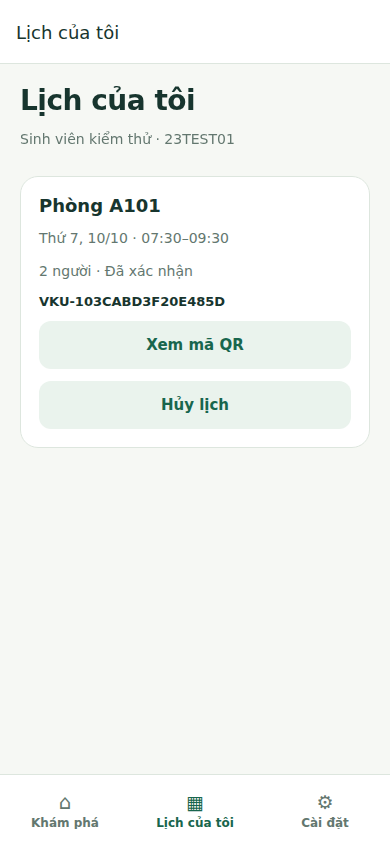

# MINI-PROJECT SHORT TECHNICAL REPORT

**Course:** Cross-Platform Mobile App Development (VKU)
**Mini-Project Title:** Mini-Project 2 - VKU Room Booking
**Team / Student Name:** Nguyễn Đăng Đức Huy - 23IT101 - 23JIT
**Submission Date:** Chưa xác định; cập nhật trước khi nộp.

---

## 1. GENERAL INFORMATION & DELIVERABLE LINKS

- **Team Members:** Nguyễn Đăng Đức Huy - Student ID: 23IT101 - Role: ứng dụng Expo, Zustand, API và kiểm thử - Contribution: 100% (bài cá nhân).
- **Live Demo URL:** Chưa phát hành link demo. QR Expo Go được lấy từ Metro trên laptop; có thể bổ sung link APK hoặc web sau triển khai.
- **GitHub Repository:** https://github.com/HuyDEV10/vku-room-booking (repository riêng cho Lab 2).
- **Video Demo:** Chưa quay video trên thiết bị thật; cần bổ sung link video 2-3 phút trước nộp.

Ứng dụng hỗ trợ tìm phòng, chọn ngày và khung giờ, đặt/hủy, hiển thị QR nhận phòng và nhắc lịch trước 15 phút. Dữ liệu mẫu có 12 phòng thuộc tòa A/B/C/V, sức chứa 2-20 và các thiết bị theo đề. Đây không phải dữ liệu chính thức về phòng học VKU. Backend và PostgreSQL chạy local, được truy cập từ điện thoại qua HTTPS tunnel. Phiên demo có token riêng, không phải xác thực tài khoản trường.

## 2. FEATURE IMPLEMENTATION CHECKLIST

|  #  | Required Feature               |               Status               | Implementation Details & Acceptance Level                                                                                                                                                                     |
| :-: | ------------------------------ | :--------------------------------: | ------------------------------------------------------------------------------------------------------------------------------------------------------------------------------------------------------------- |
|  1  | FlatList & room discovery      |           Đã triển khai            | Thẻ React.memo, ảnh local, callback ổn định; tòa/tầng/sức chứa và Available Now/Occupied dựa trên lịch hiện tại. Chưa đo 60 FPS trên thiết bị.                                                                |
|  2  | Multi-parameter filters        |            Đã kiểm thử             | Tìm tên, lọc tòa, số chỗ tối thiểu 2-20 và đủ các thiết bị đã chọn. Domain test và E2E kiểm tra kết quả lọc.                                                                                                  |
|  3  | Seven-day slot selection       |            Đã kiểm thử             | Hôm nay + 6 ngày, 4 khung 2 tiếng theo UTC+7; khung đã qua/đã đặt bị khóa. Backend kiểm tra lại ngày, slot, số người.                                                                                         |
|  4  | Conflict prevention & realtime |            Đã kiểm thử             | Partial unique index trên phòng/ngày/slot khi CONFIRMED hoặc CHECKED_IN; 4 yêu cầu đồng thời có đúng một winner. WebSocket phát sự kiện sau commit; hai browser context cập nhật khi đặt/hủy.                 |
|  5  | Unique booking code & QR       |      Đã kiểm thử trên web/API      | UUID yêu cầu và mã VKU duy nhất; modal QR chứa mã đặt chỗ. API check-in kiểm tra chủ phiên, mã và cửa sổ từ -15 phút đến trước kết thúc. Không có camera scanner trong phạm vi phiên bản này.                 |
|  6  | Zustand & AsyncStorage         |        Đã kiểm thử trên web        | useBookingStore quản lý phiên, bộ lọc, dữ liệu phòng và lịch. Persist lưu dữ liệu; chờ hydration trước render. E2E xác nhận phục hồi phiên/lịch sau reload. AsyncStorage native cần kiểm tra trên điện thoại. |
|  7  | Cancellation                   |            Đã kiểm thử             | Chỉ chủ phiên hủy lịch chưa bắt đầu/chưa check-in; khung được giải phóng và thiết bị khác cập nhật. Hủy lặp lại không tạo thay đổi sai.                                                                       |
|  8  | Local notifications            | Đã triển khai; chờ kiểm tra native | expo-notifications lập lịch trước 15 phút, đối chiếu lịch để tránh trùng/hủy nhắc cũ. Domain test xác nhận mốc giờ. Có thông báo thử riêng, không thay minh chứng nhắc thật.                                  |

Kết quả trong môi trường phát triển: 7 domain test TypeScript và 12 integration test với PostgreSQL đạt; TypeScript kiểm tra thành công; Expo Doctor 21/21 kiểm tra đạt; bundle Expo web/Android xuất thành công. E2E web kiểm tra hai phiên đặt/hủy, QR, WebSocket và lưu local. Chưa có kết quả native, đo FPS, APK cài thật hoặc video điện thoại trong bản báo cáo này.

## 3. TECHNICAL ARCHITECTURE & PROJECT STRUCTURE

| Thành phần                            | Vai trò                                                                      |
| ------------------------------------- | ---------------------------------------------------------------------------- |
| `mobile/src/screens`                  | Giao diện tìm/lọc, chọn slot, lịch đặt, phiên demo và cài đặt.               |
| `mobile/src/components`               | Thẻ phòng memoized, modal QR và thành phần giao diện chung.                  |
| `mobile/src/store/useBookingStore.ts` | Trạng thái toàn cục, persist AsyncStorage, thao tác API và phục hồi dữ liệu. |
| `mobile/src/services`                 | REST có timeout, đối chiếu thông báo đã lập với lịch còn hiệu lực.           |
| `mobile/src/hooks/useRealtime.ts`     | WebSocket, reconnect, tải lại khi foreground và theo biên thời gian.         |
| `backend/src/main`                    | Spring Boot REST/WebSocket, kiểm tra dữ liệu, giao dịch và Flyway.           |
| `backend/src/test`, `mobile/tests`    | Integration PostgreSQL, domain test và E2E web.                              |

**Luồng đặt:** chọn phòng/ngày/slot -> REST với UUID yêu cầu và token phiên -> validation backend -> INSERT trong transaction -> PostgreSQL quyết định xung đột -> trả lịch đã lưu -> Zustand cập nhật, lập nhắc và hiển thị QR. WebSocket chỉ phát sau commit để các thiết bị tải lại trạng thái đã lưu. Không broadcast dữ liệu cá nhân của người đặt.

**Chống trùng và retry:** unique index chỉ áp dụng cho lịch còn hiệu lực. Khi hai thiết bị đặt đồng thời, một yêu cầu thắng và yêu cầu còn lại nhận HTTP 409. Cùng UUID và nội dung trả cùng lịch, khác nội dung bị từ chối. Hủy thay status CANCELLED để giữ lịch sử và giải phóng khung.

**State và lỗi:** AsyncStorage lưu phiên, bộ lọc, phòng/lịch cache; API là nguồn quyết định tình trạng phòng. Mất mạng không xác nhận đặt/hủy offline. Client giữ mã yêu cầu khi thử lại cùng lựa chọn; lỗi hiển thị rõ. Khi API trả lại lịch thành công, lỗi quyền/thông báo không làm mất đặt chỗ. Cập nhật cũ đang tải không được ghi đè kết quả thao tác mới. Đổi URL tunnel cùng backend giữ phiên nếu token còn hợp lệ.

**Thời gian:** PostgreSQL lưu timestamptz; ngày và slot tính Asia/Ho_Chi_Minh. API cung cấp giờ máy chủ để UI xử lý sai lệch đồng hồ thiết bị. Mốc nhắc là startsAt - 15 phút; không lập nhắc vào quá khứ. Check-in chỉ trong cửa sổ hợp lệ; phòng Occupied trong khoảng startsAt <= now < endsAt.

## 4. EMPIRICAL EVIDENCE & SCREENSHOTS

Ảnh dưới đây chụp Expo web trong kiểm thử ở viewport mobile 390 x 844. Đây là minh chứng giao diện và luồng trình duyệt, không phải ảnh Android/iOS hoặc giả lập native. Trước nộp cần thay/bổ sung ảnh thiết bị thật theo mẫu và ghi thông tin thiết bị.

**Hình 1 - Khám phá phòng:** danh mục và bộ lọc; ảnh phòng là minh họa.

**Hình 2 - Chọn lịch:** ngày trong phạm vi 7 ngày, khung 2 tiếng và số người.

**Hình 3 - QR:** mã nhận phòng chỉ xuất hiện sau khi backend trả lịch đã lưu.

**Hình 4 - Lịch của tôi:** lịch được lưu và phục hồi theo token phiên.

Minh chứng cần hoàn thiện: thiết bị/hệ điều hành/Expo Go, ảnh FlatList/chọn lịch/QR trên điện thoại, ảnh thông báo trước 15 phút, kết quả cuộn và video 2-3 phút. Không ghi 60 FPS hoặc nhận thông báo native thành công khi chưa đo/chạy thật.

## 5. TECHNICAL CHALLENGES & RESOLUTIONS

**1. Đặt trùng giữa hai thiết bị:** khóa slot trên UI chưa đủ vì hai người có thể cùng thấy phòng trống. Partial unique index tại PostgreSQL bảo đảm một lịch còn hiệu lực mỗi khung; API xử lý 409, WebSocket cập nhật sau commit. Kiểm thử đồng thời và hai browser context kiểm tra cả dữ liệu và giao diện.

**2. Persist bất đồng bộ và vòng đời thông báo:** UI phải đợi AsyncStorage hydration để không hiển thị nhầm phiên rỗng. Thông báo được đối chiếu với lịch CONFIRMED còn trước mốc nhắc; hủy lịch/check-in/thoát phiên loại bỏ nhắc không còn cần. Lỗi quyền hoặc lập nhắc không làm rollback lịch đã lưu trên backend. Thông báo thử 10 giây tách khỏi nhắc đặt phòng.

**Phần cần hoàn tất trước nộp:** tạo link/QR demo phù hợp, chạy native và ghi kết quả thực tế, quay video, cập nhật liên kết/ngày nộp và ảnh thiết bị rồi xuất PDF cuối.
